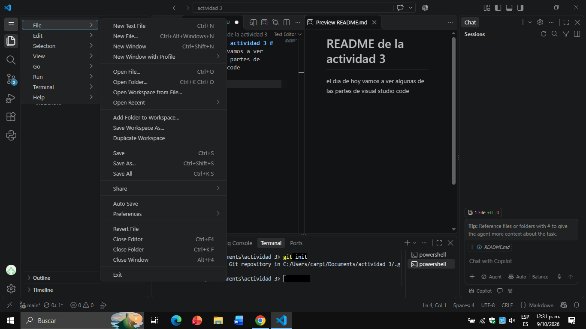
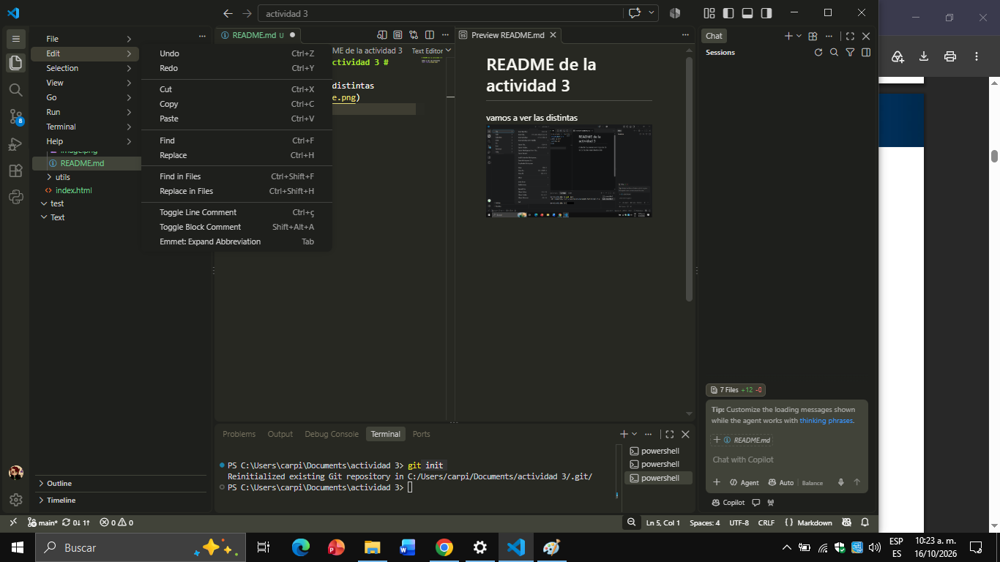
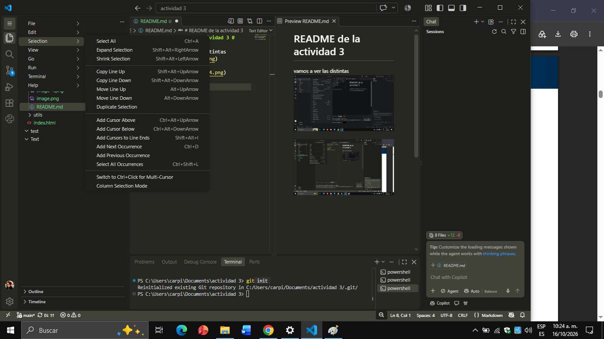
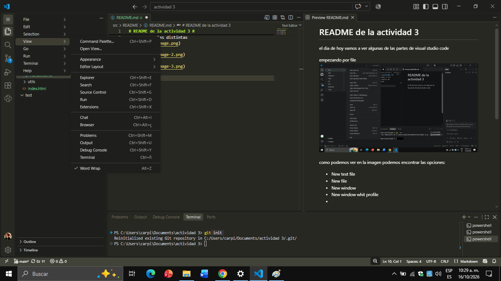
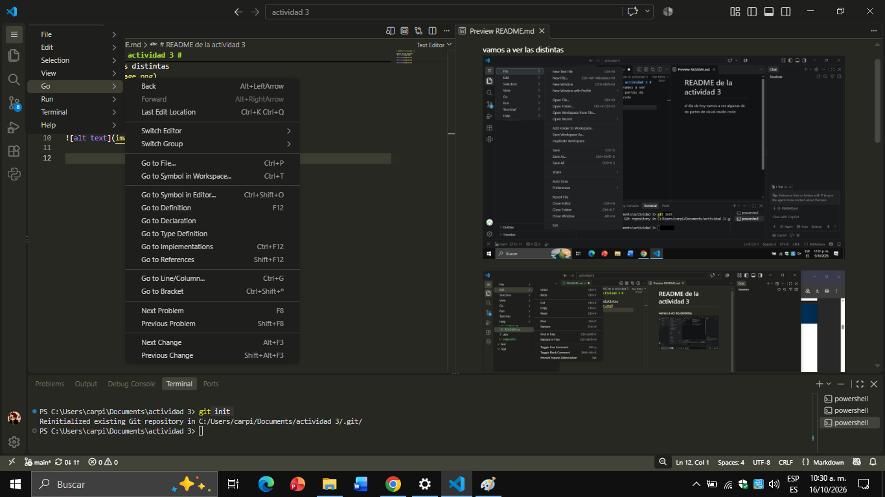
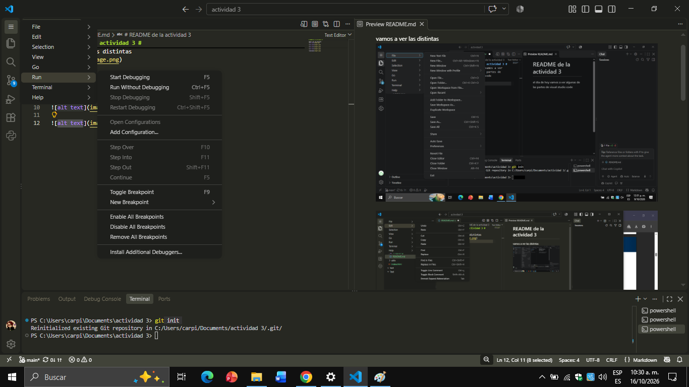
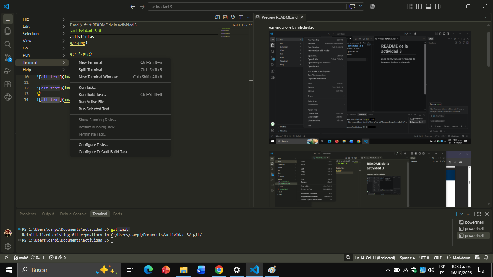
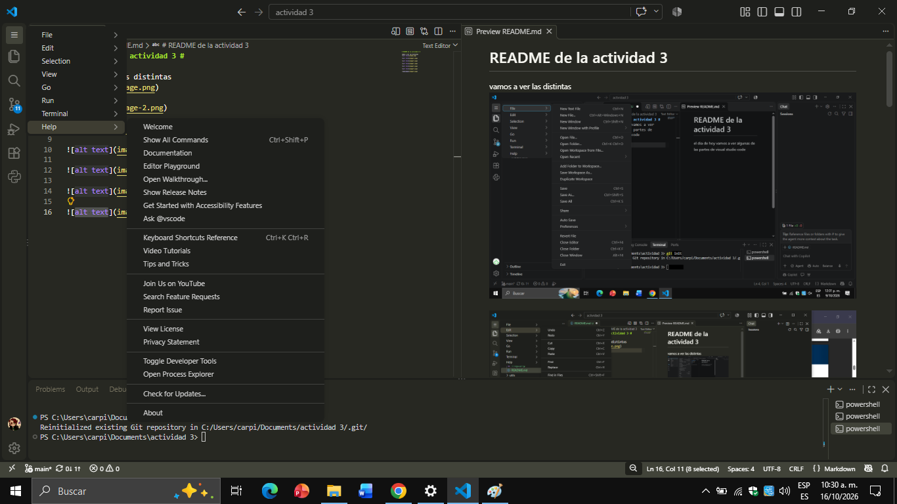

# README de la actividad 3 #

vamos a ver las funciones de las seciones y a que estan dirigidos los comandos

por ejemplo, todas las acciones y comandos de file o archivo en español estan destinada a la gestion de los archivos, crearlos, cerrarlos, abrirlos, tambien puede abrir cerrar y gestionar carpetas.
 
 

Continuamos con edit, este menú se encarga de la manipulacion del texto y codigo, gestiona el portapapeles, permite deshacer o rehacer cambios,permite encontrar palabras clave, caracteres especiales o expreciones especificas, tambien permite resaltar las lineas de codigo que uno indique, ver las palabras que se repiten y demas.
 
 

Selection se encarga de los bloques de texto resaltados y la edición múltiple, permite controlar como seleccionamos texto, ya sea una palabra o todo el contenido dentro de un parentesis, tambien la selección automática de palabras o caracteres idénticos a los que tienes resaltados para cambiarlos todos en un solo paso.
 
 

view se encarga de la configuración visual de la interfaz del editor, la visibilidad de los paneles y la disposición de las ventanas, con este se contrla la visibilidad de las barras principales, Administra la distribución de las pestañas • permitiendo dividir el área de trabajo en cuadrículas, columnas o filas para ver varios archivos a la vez, tambien nos ayuda al graduar el zoom.
 
 

se encarga de la navegación rápida, el desplazamiento entre archivos y el salto a puntos del código, con este podemos movernos entre el historial de codigo, revisar lo que programamos recietemente y lugares exactos,Administra la apertura instantánea de cualquier documento o herramienta del proyecto
 
 

run en este caso no se refiere a correr si no a ejecutar, este modulo nos permite Controlar la ejecución del código, permitiendo arrancar el programa con el depurador activo para analizarlo paso a paso, o iniciarlo sin el depurador(Run Without Debugging) para ver solo el resultado final
 
 

el modulo Terminal se encarga de la creación, el control y la organización de las líneas de comandos integradas en el entorno. Su propósito principal es permitirte interactuar directamente con el sistema operativo, ejecutar scripts, compilar código
 
 

el modulo help nos brinda soporte técnico, la documentación oficial, el diagnóstico del sistema y la verificación de actualizaciones, permite revisar informacion tecnica oficial, y avisa sobre actualizaciones 